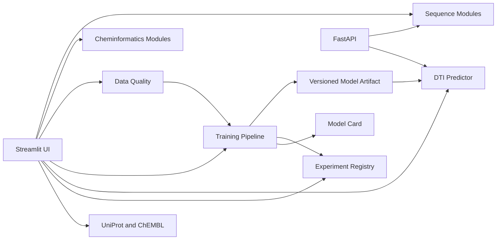

# Project Architecture

## Main package areas

- `biointel.sequence`: validation, parsing, statistics, ORFs, motifs,
  restriction sites, alignments, k-mers and oligo properties
- `biointel.chemistry`: SMILES, descriptors, fingerprints and rendering
- `biointel.dti`: drug/protein feature extraction and prediction
- `biointel.training`: splitting, evaluation, calibration, artifacts,
  explainability and experiment registry
- `biointel.integrations`: UniProt and ChEMBL clients
- `biointel.api`: FastAPI schemas and endpoints
- `biointel.reports`: PDF reports and model cards
